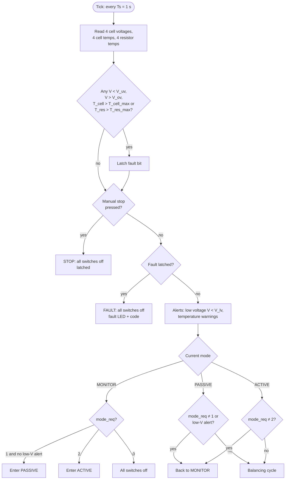
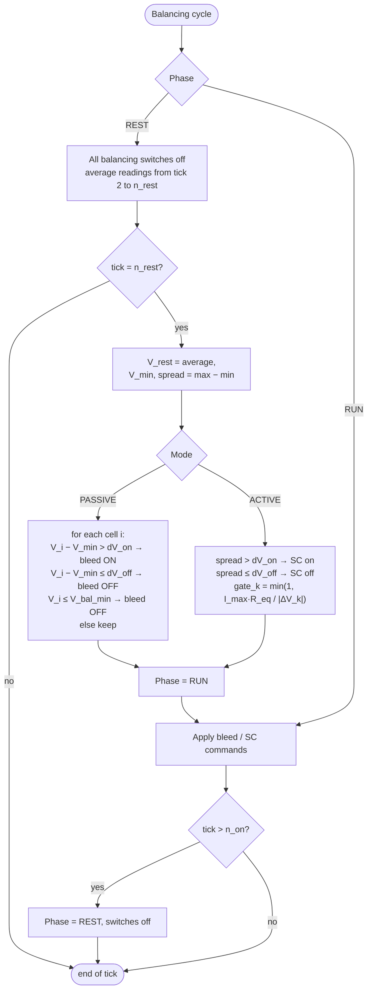

# BMS controller — flowchart

Source: [simulation/bms_4cell/src/bms_controller.m](../simulation/bms_4cell/src/bms_controller.m). One pass of this chart runs every control period `Ts` (1 s), which maps onto one iteration of the Arduino `loop()`.

## Every tick

## Balancing cycle (shared by PASSIVE and ACTIVE)

## Modes and codes

| Mode | Code | Switches | Leaves when |
|---|---|---|---|
| MONITOR | 0 | all off | `mode_req` = 1 (no low-V alert) or 2 |
| PASSIVE | 1 | bleed MOSFETs per cell | `mode_req` ≠ 1, low-V alert, fault, stop |
| ACTIVE | 2 | SC pair PWM, gated for current limit | `mode_req` ≠ 2, fault, stop |
| FAULT | 3 | all off | latched (reset / power cycle) |
| STOP | 4 | all off | latched (reset / power cycle) |

| Fault bit | Meaning | Default limit |
|---|---|---|
| 0 | under-voltage | V < 3.00 V |
| 1 | over-voltage | V > 4.25 V |
| 2 | cell over-temperature | T > 45 °C |
| 3 | bleed resistor over-temperature | T > 100 °C |

| Alert bit | Meaning | Default |
|---|---|---|
| 0 | low voltage (passive balancing inhibited) | V < 3.30 V |
| 1 | cell temperature warning | T > 40 °C |
| 2 | resistor temperature warning | T > 85 °C |
